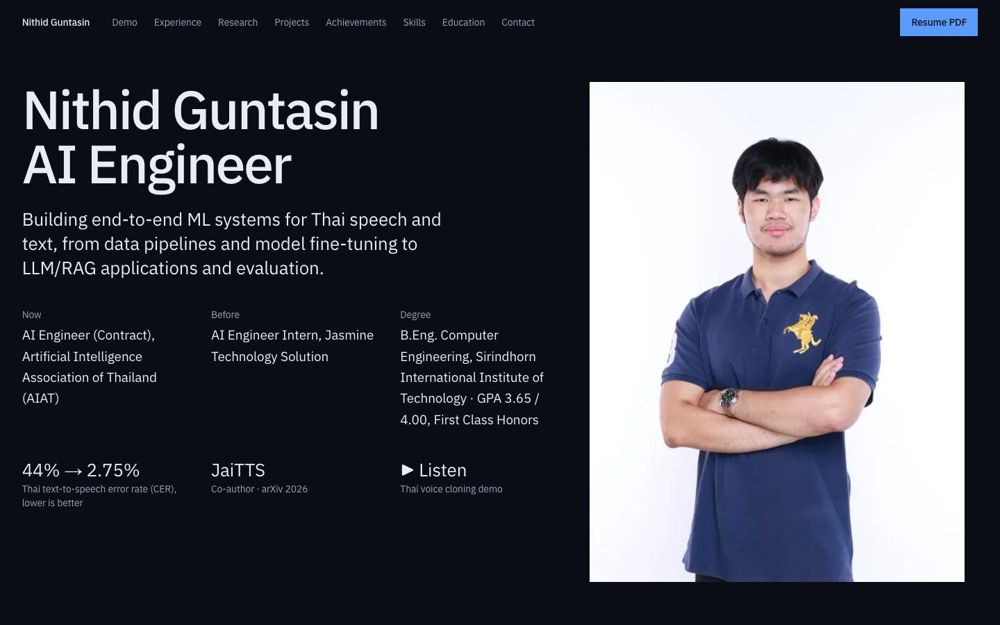

# Nithid Guntasin — Portfolio

Personal portfolio site for an AI Engineer working on Thai speech and text. Built with Next.js and Tailwind CSS.

**Live site:** [portfolio-topaz-kappa-94.vercel.app](https://portfolio-topaz-kappa-94.vercel.app/)



## Highlights

- **All content in one file.** Every role, project, metric, explanation and link lives in `data/profile.ts`, so a CV update is usually a one-file edit. Only short interface labels (section headings, "Now / Before / Degree", "Back to top") sit in the components.
- **Playable Thai voice-cloning demo** with the reference voice and generated samples side by side, each drawn as a waveform read from its own WAV file at build time.
- **Built for phones and keyboards:** a phone menu that works without JavaScript, current-section highlight, lightbox focus handling, `prefers-reduced-motion` support, content that stays visible if scripts fail, and Thai text marked with `lang="th"`.
- **Static and fast:** the whole site is prerendered, with fonts self-hosted through `next/font`.

## Tech stack

- [Next.js](https://nextjs.org/) 16 (App Router)
- [React](https://react.dev/) 19
- [TypeScript](https://www.typescriptlang.org/)
- [Tailwind CSS](https://tailwindcss.com/) 4
- [IBM Plex](https://www.ibm.com/plex/) Sans and Sans Thai via `next/font`

## Getting started

Requires Node.js 20.9 or later.

```bash
npm install
npm run dev
```

Open [http://localhost:3000](http://localhost:3000).

## Build

```bash
npm run build
npm start
```

## Test

```bash
npm test
```

Runs the checks for the WAV waveform reader in `lib/` with Node's built-in test runner. Needs Node.js 22.18 or later, which runs the TypeScript module it tests without a build step.

## Project structure

```
app/              # Next.js app router: layout, page, favicon (icon.tsx), social preview image
components/       # One component per page section (Hero, Experience, Projects, ...)
  ui.tsx          # Shared building blocks: Section, Split, Pair, BulletList, ExpandableBullets, WaveformSvg, ...
  charts.tsx      # Result bars, benchmark comparison, score bars and the human-judgment vote bars
  Pipeline.tsx    # Flow diagrams, read top to bottom
  Reveal.tsx      # Section entrances on scroll
data/profile.ts   # All site content (text, links, metrics)
lib/waveform.ts   # Reads the demo WAVs at build time for the waveform drawings (tested in waveform.test.mjs)
docs/             # README screenshot
public/           # Static assets
  audio/          # Voice cloning demo samples
  super-ai/       # Super AI Engineer winning-team photos
  projects/       # Project screenshots
```

## Updating content

| What to change | Where |
|---|---|
| Name, title, tagline, contact links | `profile` in `data/profile.ts` |
| Hero proof points | `profile.highlights` (the Now / Before / Degree facts are built from `jobs` and `education`) |
| Work experience and key results | `jobs` (`summary`, `keyResults` + `keyResultsNote`, optional `benchmark` comparison and `pipeline` diagram, then `bullets` or labelled `bulletGroups`; `id` for links straight to a job) |
| Voice demo samples | `voiceDemo` (incl. the listening `instruction`) + 16-bit PCM WAV files in `public/audio/` |
| Projects, incl. how it works and results | `projects` (`summary`, `results` + `resultsNote`, `pipeline`, `screenshots` + files in `public/projects/`, `link` or `linkNote` when the code is private) |
| Super AI highlights and photos | `superAI` (`highlights`, `photos`) + files in `public/super-ai/` |
| Research (incl. the human-judgment chart, `publication.humanEval`), other hackathons, skills, education | matching export in `data/profile.ts` |
| Colours and type sizes | `--color-*` and `--text-*` in `app/globals.css` (accent: `--color-accent`, `--color-accent-strong`); `app/icon.tsx` and `app/opengraph-image.tsx` repeat the hex values |
| Fonts | `app/layout.tsx` |
| Resume file | replace `public/Resume_NithidGuntasin.pdf` |
| Profile photo | replace `public/photo.jpg` (also used in the social preview image) |
| Page title / SEO description | built from `profile` in `app/layout.tsx` |

## Deploy

Hosted on [Vercel](https://vercel.com/). Every push to `main` deploys to the live site automatically.
